  

## 👋 About me

Full Stack Developer based in São Paulo, Brazil. I build the internal platforms a support team runs on, and I spend my free time making teams of AI agents work together on real software.

At **Lukos Tecnologia** (ERP and point-of-sale software for fuel stations and retail) I built the WhatsApp support CRM, an AI agent that takes the first pass on every new ticket, and the .NET installer that puts the POS system in customers' stores. Outside work I run **Zenrick**, my own platform for coordinating AI coding agents, and I co-founded **Sementia**, which builds sales and automation systems for small businesses.

## 📊 Impact at a glance

| 🎫 Tickets | 💬 Messages | 🤖 AI agent | 🚀 Deploys | 🧩 Services | 📝 Commits |
|:---:|:---:|:---:|:---:|:---:|:---:|
| **~6.7k** per 90 days in the CRM | **~120k** WhatsApp messages / 90 days | **~100/day** tickets handled by LUK | **~20/week** to production | **16** running in production | **~2,000** in 15 months at Lukos |

## 💼 What I'm building

<b>Lukos Tecnologia</b> · Full Stack Developer · <i>click to collapse</i>

 

- **Support CRM** used by 16 agents across N1, N2 and N3, on top of the company panel. React, TypeScript, Express, Prisma and SQL Server.
- **LUK**, a level-0 AI support agent with N1 permissions, kill switch, rate caps and a full audit trail. It handles every new ticket first and escalates only what it can't solve yet.
- **AI with human approval:** handoff summaries for N2 and AI replies that wait for Send / Edit / Cancel before reaching the customer.
- **.NET 10 POS installer** with 600+ tests (xUnit, BDD, UI automation). SQL Server crash detection dropped from ~9 minutes to ~1.
- **Production:** 16 services on Docker and Dokploy, MCP servers and a RAG knowledge base over SQL Server.

<b>Zenrick</b> · Founder · my platform for teams of AI agents · <i>click to expand</i>

 

Shared memory, task routing and human approval gates for up to 17 AI coding agents working in parallel. Source is private; happy to walk through the architecture in an interview.

| Project | What it does | Stack |
|---|---|---|
| **NexusCore** | Shared memory and coordination for AI agents: hybrid search (vectors, full text, trigrams), work leases, a message board across machines and an MCP server. | `NestJS` `PostgreSQL` `pgvector` `Redis` `MinIO` `MCP` |
| **ZenKit** | Installable kit of agents, skills and rules for Claude Code and Cursor. Routes each task to the cheapest capable model and reviews every diff before merge. | `TypeScript` `MCP` |
| **Kyron** | Personal assistant on WhatsApp that answers with sources from shared memory and sends proactive briefs. | `Python` `LLMs` `Evolution API` |
| **Pixion** | AI image product: Android app, web app and a GPU engine for generation, upscaling and background removal. | `Kotlin` `Next.js` `FastAPI` `Stable Diffusion` |
| **Infrastructure** | Linux hosts on a private mesh, containers, reverse proxy, object storage, backups and monitoring. | `Docker` `Traefik` `Dokploy` `Tailscale` |

<b>Sementia</b> · Co-founder · sales and automation for small businesses · <i>click to expand</i>

 

- **B2B prospecting platform:** search over Brazil's public company registry, daily automatic prospecting, sales kanban and email and WhatsApp campaigns.
- **AI qualification agent** that talks to leads around the clock and hands sales a qualified contact.
- White-label versions running for clients, each with its own data, brand and deployment.

`Next.js` `React` `Supabase` `PostgreSQL` `pg-boss` `Anthropic SDK` `MCP`

## 🛠️ Public projects

<table>
<tr>
<td width="50%" valign="top">

### 🔎 vektor-job-engine
Collects remote job postings from 8 boards, parses salaries in USD and BRL and keeps only the ones that fit: stack, seniority, years asked and salary floor. **82 tests, zero dependencies.**

`TypeScript` `Node.js`

</td>
<td width="50%" valign="top">

### 💰 wallethub-snapshot
Personal finance app I use for my own money: imports bank statements (OFX and CSV), reconciles transactions and sorts them into categories. Multi-tenant by organization.

`NestJS` `React` `PostgreSQL` `Redis`

</td>
</tr>
<tr>
<td width="50%" valign="top">

### 🧭 Vektor
Career platform I run in production: live meeting copilot, a drill engine with 31 question families, and job collection and scoring. **431 automated tests.** Private source, public product.

`Next.js` `TypeScript` `PostgreSQL`

</td>
<td width="50%" valign="top">

### 📦 zenkit-releases
Signed executor and launcher binaries for ZenKit. Shows how the kit is distributed: versioned releases with hash and signature checks.

`Releases` `Code signing`

</td>
</tr>
</table>

## 🧰 Tech stack

**Languages** 

**Frontend** 

**Backend** 

**Data** 

**AI and agents** 

**DevOps** 

**Testing** 

## 📫 Let's talk

Looking for a **remote full stack role**, contractor first and full-time welcome. 
The fastest way to reach me is LinkedIn or email.

 

  

