  

 

  
  
  

 

### About me

Full stack developer based in São Paulo, Brazil (UTC-3). I build and maintain, end to end, the platform a support team uses to serve the customers of a retail software company (ERP and point of sale): the web CRM in React and the REST API in Node.js and TypeScript behind it. I also wrote the .NET installer that delivers the point-of-sale system to customers' stores and set up the team's CI/CD.

I started in technical support and have been developing full time for the last 2 years, so I know how customers actually use the product. Outside work I run my own projects in production, handling the servers, deployment and monitoring myself.

- **Looking for:** a remote full stack or solutions and integrations role.
- **English:** professional.

---

### Public projects

| Project | What it does | Stack |
|---------|--------------|-------|
| **[wallethub-snapshot](https://github.com/Caio-HD/wallethub-snapshot)** | Personal finance app I use for my own money: imports bank statements (OFX/CSV), reconciles transactions and sorts them into categories. Multi-tenant by organization. One-time snapshot of a private repo. | `NestJS` `React` `PostgreSQL` `Redis` |
| **[vektor-job-engine](https://github.com/Caio-HD/vektor-job-engine)** | Engine that collects remote job postings from 8 boards, parses salaries in USD and BRL and keeps only the ones that fit (stack, seniority, years asked, salary floor). 82 tests, no dependencies. | `TypeScript` `Node.js` |
| **[Vektor](https://vektor.zenrick.dev)** | Career platform I run in production: live meeting copilot, a drill engine with 31 question families, and job collection and scoring. Private source, public product, 431 automated tests. | `Next.js` `PostgreSQL` `TypeScript` |

---

### Zenrick ΓÇö my own ecosystem (private)

A set of products and services I designed, built and run myself, on my own servers.

| Project | What it does | Stack |
|---------|--------------|-------|
| **NexusCore** | Shared memory for AI agents: knowledge, events and project state with hybrid semantic search, exposed as an MCP server so every assistant and IDE works from the same context. | `NestJS` `PostgreSQL` `pgvector` `Redis` `MinIO` `MCP` |
| **Kyron** | Personal assistant on WhatsApp for me and a few people close to me. First built as my own Python service; now runs on the open-source Hermes Agent, with my own memory (NexusCore), Google integrations, voice messages and per-user data isolation. | `Python` `LLMs` `WhatsApp (Evolution API)` `Hermes Agent` |
| **Pixion** | AI image product in three parts: an Android app, a web app, and a GPU engine for generation, upscaling, face restoration and background removal, run as queued jobs. | `Kotlin` `Jetpack Compose` `Next.js` `Firebase` `Python` `FastAPI` `Stable Diffusion` `Real-ESRGAN` `OpenCV` |
| **ZenKit** | Toolkit that keeps several AI coding tools on the same rules, routes tasks between them and checks every diff before it is merged. | `TypeScript` `MCP` |
| **Infrastructure** | The platform behind all of it: several Linux hosts on a private mesh, containers, reverse proxy, object storage, backups and monitoring. | `Docker` `Traefik` `Dokploy` `Tailscale` `Linux` |

I also run Sementia, a small web studio with a partner, building sites for local businesses. All of this code is private; happy to walk through the architecture in an interview.

---

### Tech stack

  
  
  
  
  
  
  
  

  
  
  
  
  
  

**Also work with:** Kotlin ┬╖ Jetpack Compose ┬╖ FastAPI ┬╖ pgvector ┬╖ MCP ┬╖ Ollama ┬╖ Firebase ┬╖ Traefik ┬╖ Dokploy ┬╖ MinIO ┬╖ Tailscale ┬╖ n8n

 

  

